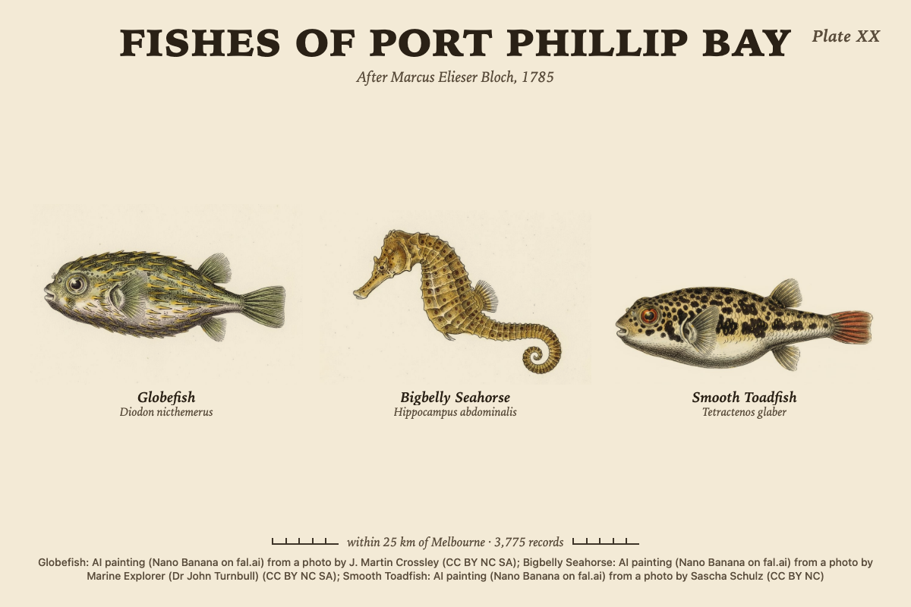
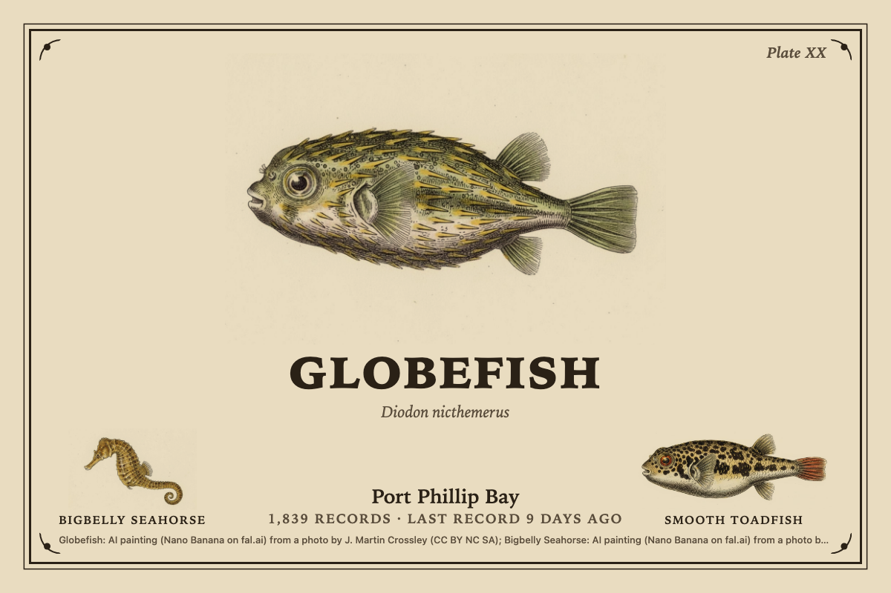
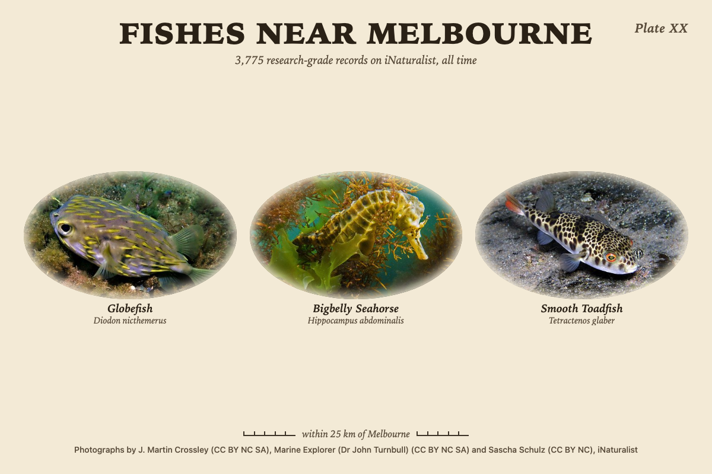
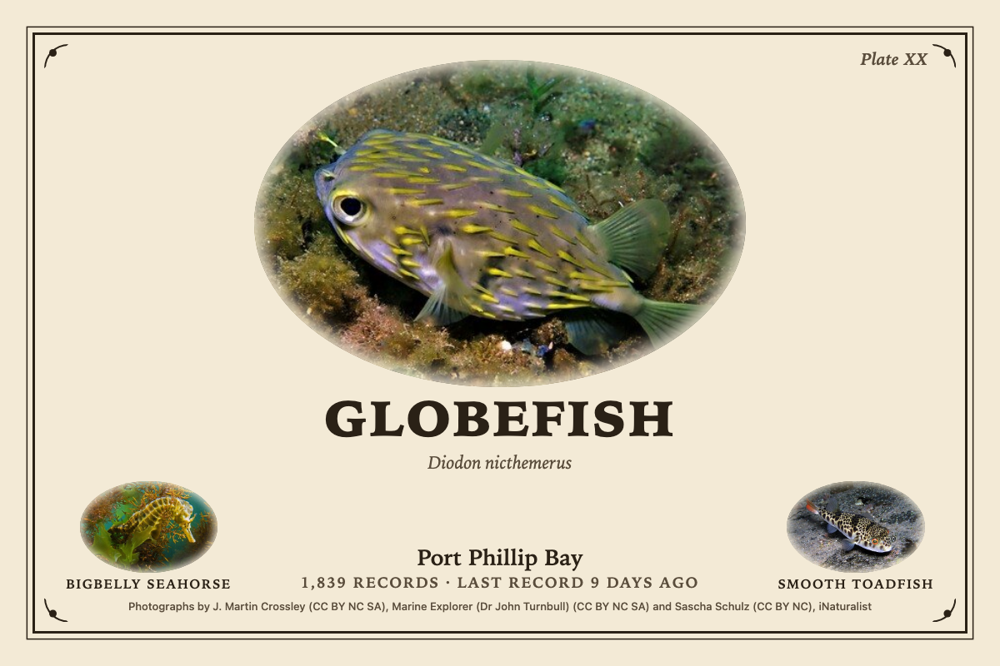
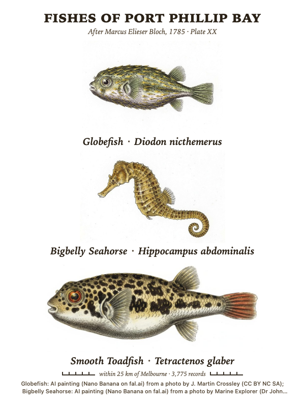
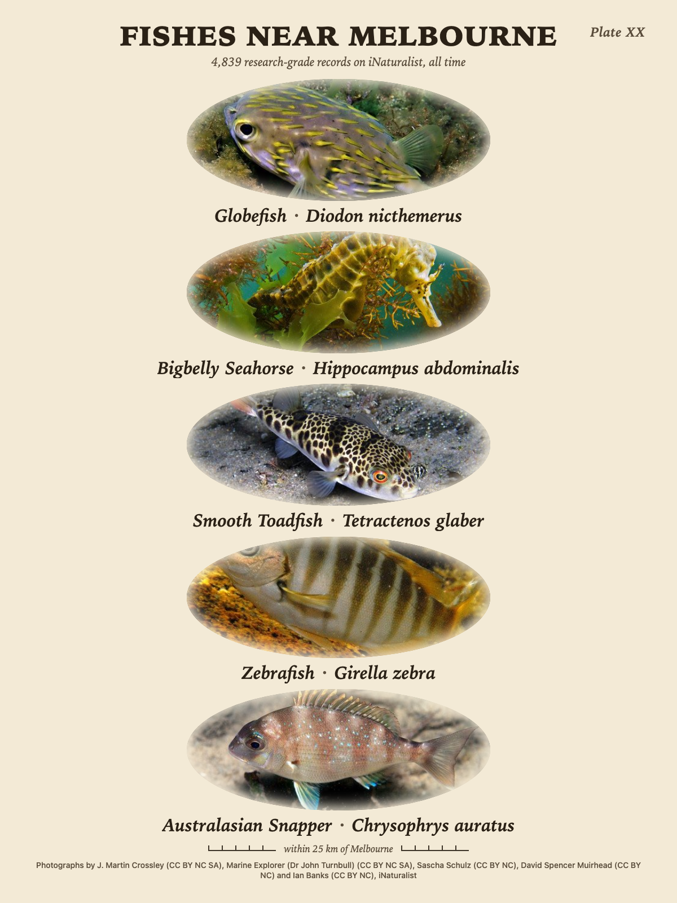
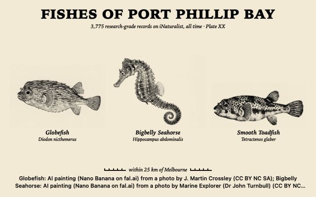
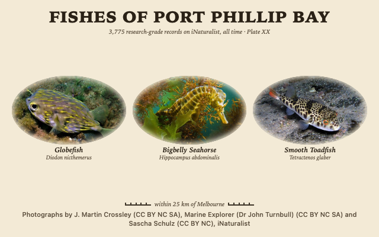
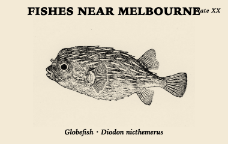
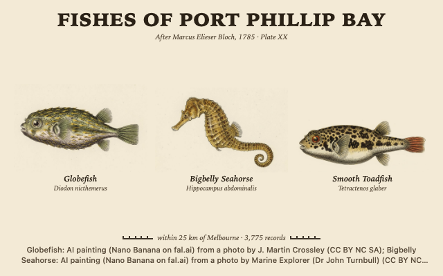

# fish_plate

The fishes of the waters around the panel, as a natural-history plate: the
most recorded species on iNaturalist within a radius of a place, in lateral
view, stacked on cream paper with their names in script beneath, a plate title
and number, and a scale bar at the foot.

## Where the fishes come from

Every species on the plate is a research-grade record on
[iNaturalist](https://www.inaturalist.org): a ray-finned fish (Actinopterygii)
that at least two people agreed on, with a photo under a Creative Commons
licence (CC0, BY, BY-NC, BY-SA, BY-NC-SA, BY-ND or BY-NC-ND). The widget asks
for the species counts within the radius of the place, ranks them by how many
records each has, and takes the top one to five. Each species carries its
best open photo (the taxon's own default photo when it is openly licensed,
else the first open one among the taxon's curated photos, else the latest
record's), the photographer and licence, its latest record and its count.

Limits worth knowing:

- The plate shows what people have recorded and photographed, which is not the
  same as what lives there. Divers' favourites and shore fish are over-represented;
  deep, shy and small fish are under-represented.
- "Research grade" means community-agreed, not expert-verified.
- A species whose photos are all rights reserved is left off, since the widget
  cannot show (or paint from) a photo it may not use.
- Records are cached for six hours per place and window, so a new observation
  takes up to that long to appear.

An iNaturalist username can stand in for the place: the plate then shows that
person's most recorded fishes, wherever they found them.

## Pictures

**Photographs** cost nothing: each species' photo in a soft oval, feathered
into the paper, with the photographer and licence in the credits line.

**AI paintings** paint each fish once per style from that photo, through the
host's artwork collection (Tesserae 0.463 or later, with a fal.ai key in this
widget's settings or under Settings, Generative AI). The painter is asked for
the whole fish alone in lateral view facing left, fins spread, every scale and
ray drawn, on plain white paper with no water, background, text or shadow. The
painting's own paper is then made white and cropped to the fish, so it sits on
the plate's paper as if printed there. Until a painting lands the photograph
shows, and the editors poll while the work is on the way. A painting is kept
on disk and never paid for twice; the paintings page at
`/plugins/fish_plate/artwork/plates/` lists them with Repaint and Delete.

Five styles: hand-coloured engraving after Bloch (the default; the plate's
subtitle then reads "After Marcus Elieser Bloch, 1785"), gyotaku ink print,
watercolour, woodcut, and scientific line drawing. Gyotaku and the line
drawing are black ink only, the ones for a black and white panel.

## Two layouts

**Stacked plate** is the fishes one above another, each spanning most of the
width, with "Common name · Scientific name" in an italic serif beneath, the
title at the top, the plate number top right, and a scale bar at the foot that
carries the area and record count. On a landscape cell where the stack would
leave each fish under two fifths of the height, the fishes go side by side
instead (two or three across, four as two rows of two, five as three over two)
with each caption under its fish, so the fish stays the biggest thing on the
page in every cell shape. Portrait cells keep the stack; sm shows one fish and
its name. Where the cell is under 700 px wide the plate number moves into the
subtitle line so the title keeps to one line.

**Hero** is the most recorded fish large across the page inside a double ruled
frame with corner flourishes, its name in large serif capitals beneath, the
waters and record count small, and the next two species as small fishes in
the lower corners with their names in small capitals.

## Built for e-ink

The paper (cream, white or aged) and the ink are literal, as a printed page is,
so the plate looks the same on every theme. The `Panel` option converts and
contrast-stretches the pictures for a greyscale or black and white panel and
thickens the type on black and white; with gyotaku or the line drawing a mono
panel gets a plate that was black ink to begin with. Nothing animates, nothing
is fetched from the browser, and the type uses the plate's serif stack with
the browser's own serif as the fallback (no webfont is loaded).

## Options

Place, source, how many, layout and pictures are always shown; the style
appears with AI paintings; the rest sit under **More options**.

| Option | Notes |
| --- | --- |
| Place | Whose waters to draw. Falls back to the app-level location. |
| Source | Records near the place, or one iNaturalist user's records (then a username field). |
| Within | 5 to 100 km round the place. Default 25 km. |
| How many | 1 to 5 species, the most recorded first. Default 3. |
| Layout | Stacked plate or Hero. |
| Pictures | Photographs, or AI paintings (about US$0.04 a species, once per style). |
| Style | With AI paintings: after Bloch, gyotaku, watercolour, woodcut, line drawing. |
| Window | More options. All time (default), this year, or the last 90 days. |
| Waters | More options. The water's name for the title: FISHES OF <waters>. Blank gives FISHES NEAR <place>. |
| Paper | More options. Cream, white or aged. |
| Panel | More options. Colour, 16 greys, 4 greys, or black and white. |
| Model | More options, with AI paintings. Nano Banana (default), Nano Banana Pro, FLUX.1 Kontext Pro, GPT Image 2, Seedream 4. |
| Title | More options. Overrides the title entirely. |
| Credits | More options. The photographers and licences at the foot; on by default, as the CC licences ask. |

Settings (one set for every cell): the fal.ai key, a painting budget per day
(default US$2), and how many new paintings one preview may start (default 3).

## Screenshots

| | |
| --- | --- |
|  |  |
| Stacked plate, three Bloch paintings across, 1200x800 | Hero, Bloch paintings on aged paper, 1200x800 |
|  |  |
| Stacked plate, three photographs across, 1200x800 | Hero, photographs, 1200x800 |
|  |  |
| Portrait half panel, Bloch paintings on white paper, 600x800 | 13.3" portrait, five species in photographs, 1200x1600 |
|  |  |
| Gyotaku ink prints on a black and white panel, 640x400 | Photographs at md, 640x400, three across |
|  |  |
| One gyotaku fish at sm on a black and white panel, 380x240 | Bloch paintings under the dark theme, 640x400 (the paper stays paper) |

## Licence

AGPL-3.0. See [LICENSE](LICENSE). Species, photos and counts from
[iNaturalist](https://www.inaturalist.org) under each photo's own Creative
Commons licence; the photographer and licence are printed on the plate and
should be kept with any copy. AI paintings are made with the models listed
above on [fal.ai](https://fal.ai) from those photos and credited to the
photographer as derivatives. Marcus Elieser Bloch's *Allgemeine
Naturgeschichte der Fische* (1782 to 1795) is the model for the default style;
nothing of it is copied.
